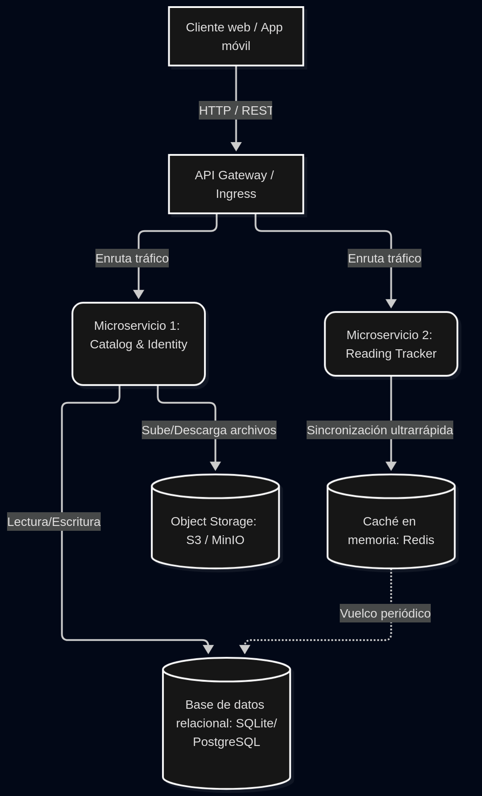

# VaporShelf — Un gestor de documentos y lecturas en la nube

`VaporShelf` es una aplicación nativa de la nube orientada a la gestión, consulta y seguimiento del estado de lectura de libros y documentos digitales.

---

## 1. Descripción del dominio

El objetivo principal de `VaporShelf` es centralizar la lectura y gestión de libros y documentos en un solo lugar. Los usuarios pueden almacenar archivos en un catálogo y leerlos en múltiples dispositivos sin perder la posición de lectura.

### Casos de uso principales
1. **Gestión y subida de documentos:** Los usuarios pueden subir archivos, como puede ser un PDF o un ePub, y decidir si cualquiera puede leerlos o no marcándolos como públicos o como privados.
2. **Control de acceso a documentos privados:** Los usuarios pueden solicitar permisos de acceso a documentos privados de otros usuarios, así como autorizar o no el acceso de otros usuarios a sus documentos privados.
3. **Seguimiento de lectura:** Se registra la página/posición exacta de lectura para retomar la sesión sin interrupciones desde cualquier otro dispositivo.

## 2. Justificación NIST SP 800-145

La solución se alinea con las 5 características esenciales de la computación en la nube según el estándar **NIST SP 800-145**:

- **Autoservicio bajo demanda:** Los usuarios pueden registrarse, subir archivos y gestionar accesos de forma completamente automatizada mediante servicios web sin intervención manual del proveedor.
- **Acceso amplio a la red:** Las funcionalidades del sistema y la lectura de documentos son accesibles a través de protocolos estándar de Internet (HTTP/REST) desde clientes web, aplicaciones móviles o lectores digitales.
- **Asignación común de recursos:** La infraestructura subyacente (motores de base de datos, almacenamiento masivo de objetos y caché en memoria) comparte recursos físicos y lógicos multiinquilino, aislados a nivel de aplicación.
- **Rápida elasticidad:** Al desvincular el microservicio de lectura del microservicio de almacenamiento, la capa de seguimiento (alta frecuencia de peticiones) puede escalar horizontalmente en picos de lectura intensiva de manera independiente.
- **Servicio medido:** Se monitoriza y mide automáticamente el uso de recursos, como la cuota de almacenamiento consumida por usuario y la frecuencia de peticiones a la API REST.

---

## 3. Mapeo de actores y roles NIST SP 500-292

Conforme al estándar **NIST SP 500-292**, se establecen los siguientes roles:

| Rol | Componente / entidad | Función en el sistema | Impacto económico / operativo |
| :--- | :--- | :--- | :--- |
| **Consumidor** | Usuario lector / autor | Consume *endpoints* REST para subir documentos y registrar su lectura. | Reduce la necesidad de almacenamiento físico e infraestructura propia. |
| **Proveedor** | Infraestructura *cloud* (AWS / GCP / K8s) | Proporciona el entorno de ejecución, contenedores, persistencia y almacenamiento de objetos. | Costes escalables bajo modelo *pay-as-you-go* optimizando costes fijos. |
| **Intermediario** | API Gateway / Ingress | Encaminamiento de tráfico, autenticación unificada y balanceo de carga. | Minimiza el acoplamiento y simplifica la gestión de seguridad centralizada. |
| **Auditor** | Sistema de *logs* y observabilidad | Evaluación del rendimiento, cumplimiento de métricas de servicio y seguridad. | Garantiza la trazabilidad del sistema y detección de anomalías. |
| **Operador** | Redes y proveedores de conectividad | Infraestructura de red que garantiza la transmisión de datos entre cliente y la nube. | Determina latencias en el envío de páginas y descarga de archivos. |

---

## 4. Arquitectura de referencia

El sistema está diseñado como una arquitectura de microservicios con separación de persistencia y caché en memoria. A continuación se detalla esta con sus componentes y protocolos de comunicación:



* **Microservicio 1 (*Catalog & Identity*):** Gestiona usuarios, visibilidad de libros y subidas.
* **Microservicio 2 (*Reading Tracker*):** Administra el progreso de lectura de forma rápida.
* **Persistencia:** Base de datos relacional para metadatos y *Object Storage* para archivos PDF/ePub.
* **Caché:** Redis para la sincronización rápida del progreso de lectura.

---

## 5. Especificación de la API REST

### Microservicio 1: *Catalog & Identity Service*

#### `POST /documents`
Carga un nuevo documento en el sistema.
- **Payload de solicitud (JSON):**
  ```json
  {
    "title": "Arquitectura Cloud Native",
    "is_private": true,
    "file_type": "pdf"
  }
  ```

#### `GET /documents/{document_id}`
Obtiene los metadatos y el enlace de descarga de un documento.

---

### Microservicio 2: *Reading Tracker Service*

#### `PUT /documents/{document_id}/progress`
Actualiza la posición o página de lectura de un usuario para un documento concreto.
- **Payload de solicitud (JSON):**
  ```json
  {
    "user_id": "usr-102",
    "current_page": 42,
    "total_pages": 300
  }
  ```

#### `GET /documents/{document_id}/progress`
Recupera el último punto de lectura guardado.
