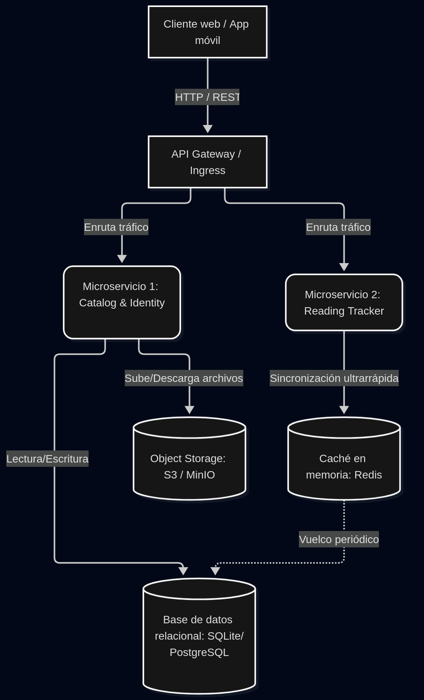

# VaporShelf — Un gestor de documentos y lecturas en la nube

`VaporShelf` es una aplicación nativa de la nube orientada a la gestión, consulta y seguimiento del estado de lectura de libros y documentos digitales.

---

## 1. Descripción del dominio

El objetivo principal de `VaporShelf` es centralizar la lectura y gestión de libros y documentos en un solo lugar. Los usuarios pueden almacenar archivos en un catálogo y leerlos en múltiples dispositivos sin perder la posición de lectura.

### Casos de uso principales
1. **Gestión y subida de documentos:** Los usuarios pueden subir archivos, como puede ser un PDF o un ePub, y decidir si cualquiera puede leerlos o no marcándolos como públicos o como privados.
2. **Control de acceso a documentos privados:** Los usuarios pueden solicitar permisos de acceso a documentos privados de otros usuarios, así como autorizar o no el acceso de otros usuarios a sus documentos privados.
3. **Seguimiento de lectura:** Se registra la página/posición exacta de lectura para retomar la sesión sin interrupciones desde cualquier otro dispositivo.

---

## 2. Justificación NIST SP 800-145

La solución se alinea con las 5 características esenciales de la computación en la nube según el estándar **NIST SP 800-145**:

- **Autoservicio bajo demanda:** Los usuarios pueden registrarse, subir archivos y gestionar accesos de forma completamente automatizada mediante servicios web sin intervención manual del proveedor.
- **Acceso amplio a la red:** Las funcionalidades del sistema y la lectura de documentos son accesibles a través de protocolos estándar de Internet (HTTP/REST) desde clientes web, aplicaciones móviles o lectores digitales.
- **Asignación común de recursos:** La infraestructura subyacente (motores de base de datos, almacenamiento masivo de objetos y caché en memoria) comparte recursos físicos y lógicos multiinquilino, aislados a nivel de aplicación.
- **Rápida elasticidad:** Al desvincular el microservicio de lectura del microservicio de almacenamiento, la capa de seguimiento (alta frecuencia de peticiones) puede escalar horizontalmente en picos de lectura intensiva de manera independiente.
- **Servicio medido:** Se monitoriza y mide automáticamente el uso de recursos, como la cuota de almacenamiento consumida por usuario y la frecuencia de peticiones a la API REST.

---

## 3. Mapeo de actores y roles NIST SP 500-292

Conforme al estándar **NIST SP 500-292**, se establecen los siguientes roles:

| Rol | Componente / entidad | Función en el sistema | Impacto económico / operativo |
| :--- | :--- | :--- | :--- |
| **Consumidor** | Usuario lector / autor | Consume *endpoints* REST para subir documentos y registrar su lectura. | Reduce la necesidad de almacenamiento físico e infraestructura propia. |
| **Proveedor** | Infraestructura *cloud* (AWS / GCP / K8s) | Proporciona el entorno de ejecución, contenedores, persistencia y almacenamiento de objetos. | Costes escalables bajo modelo *pay-as-you-go* optimizando costes fijos. |
| **Intermediario** | API Gateway / Ingress | Encaminamiento de tráfico, autenticación unificada y balanceo de carga. | Minimiza el acoplamiento y simplifica la gestión de seguridad centralizada. |
| **Auditor** | Sistema de *logs* y observabilidad | Evaluación del rendimiento, cumplimiento de métricas de servicio y seguridad. | Garantiza la trazabilidad del sistema y detección de anomalías. |
| **Operador** | Redes y proveedores de conectividad | Infraestructura de red que garantiza la transmisión de datos entre cliente y la nube. | Determina latencias en el envío de páginas y descarga de archivos. |

---

## 4. Arquitectura de referencia

El sistema está diseñado como una arquitectura de microservicios con separación de persistencia y caché en memoria. A continuación se detalla esta con sus componentes y protocolos de comunicación:



* **Microservicio 1 (*Catalog & Identity* — `catalog_service`):** Implementado con FastAPI (puerto `8000`). Gestiona los metadatos de los documentos, su visibilidad (pública o privada), las solicitudes de acceso y la generación de enlaces de descarga contra el almacenamiento de objetos.
* **Microservicio 2 (*Reading Tracker* — `tracker_service`):** Implementado con FastAPI (puerto `8001`). Administra y calcula el progreso de lectura multiusuario con baja latencia.
* **Persistencia:** Base de datos relacional **PostgreSQL 16** para metadatos y permisos, junto con almacenamiento de objetos compatible con **S3** (implementado con **SeaweedFS** bajo el alias de servicio `minio`) para archivos PDF/ePub.
* **Caché y estado rápido:** **Redis 7** con persistencia AOF (*Append-Only File*) para sincronizar el progreso de lectura sin pérdida de datos entre reinicios.

---

## 5. Especificación de la API REST

Ambos microservicios exponen documentación interactiva OpenAPI/Swagger automáticamente en `/docs` una vez levantado el entorno.

### Microservicio 1: *Catalog & Identity Service* (`:8000`)

#### `GET /health`
Comprueba el estado de salud del microservicio (`{"status": "ok"}`).

#### `POST /documents`
Registra un nuevo documento en el catálogo.
- **Payload de solicitud (JSON):**
  ```json
  {
    "title": "Arquitectura Cloud Native",
    "is_private": true,
    "file_type": "pdf",
    "owner_id": "usr-101"
  }
  ```

#### `GET /documents/{document_id}?user_id={user_id}`
Obtiene los metadatos y el enlace de descarga (`download_url`) de un documento si es público, si el solicitante es su propietario o si dispone de acceso aprobado. En caso contrario devuelve `403 Forbidden`.

#### `POST /documents/{document_id}/access-requests`
Registra una solicitud de permiso de lectura sobre un documento privado.
- **Payload de solicitud (JSON):**
  ```json
  {
    "requester_id": "usr-102"
  }
  ```

#### `PUT /documents/{document_id}/access-requests/{requester_id}`
Permite al propietario del documento aprobar o denegar una solicitud de acceso pendiente.
- **Payload de solicitud (JSON):**
  ```json
  {
    "owner_id": "usr-101",
    "approved": true
  }
  ```

---

### Microservicio 2: *Reading Tracker Service* (`:8001`)

#### `GET /health`
Comprueba el estado de salud del microservicio (`{"status": "ok"}`).

#### `PUT /documents/{document_id}/progress`
Actualiza la posición o página de lectura de un usuario para un documento concreto y valida la coherencia de los números de página.
- **Payload de solicitud (JSON):**
  ```json
  {
    "user_id": "usr-102",
    "current_page": 42,
    "total_pages": 300
  }
  ```

#### `GET /documents/{document_id}/progress?user_id={user_id}`
Recupera el último punto de lectura guardado para el usuario indicado y su porcentaje calculado.

---

## 6. Estructura del repositorio

```text
.
├── .github/
│   ├── ISSUE_TEMPLATE/
│   │   └── user_story.md             # Plantilla estandarizada para historias de usuario
│   ├── PULL_REQUEST_TEMPLATE.md      # Plantilla para revisiones y entregas por PR
│   └── workflows/
│       └── ci.yml                    # Pipeline de integración continua y publicación en GHCR
├── assets/
│   └── diagrama_de_arquitectura.png  # Diagrama formal de la arquitectura
├── catalog_service/
│   ├── app/                          # Código fuente FastAPI, lógica de acceso y clientes BD/S3
│   ├── tests/
│   │   ├── unit/                     # Pruebas unitarias aisladas (lógica de negocio)
│   │   └── integration/              # Pruebas de integración contra PostgreSQL y S3
│   ├── Dockerfile                    # Imagen de producción multietapa (puerto 8000)
│   ├── requirements.txt              # Dependencias de ejecución
│   └── requirements-dev.txt          # Dependencias de desarrollo, linters y pruebas
├── tracker_service/
│   ├── app/                          # Código fuente FastAPI, cálculo de progreso y cliente Redis
│   ├── tests/
│   │   ├── unit/                     # Pruebas unitarias aisladas
│   │   └── integration/              # Pruebas de integración contra Redis
│   ├── Dockerfile                    # Imagen de producción multietapa (puerto 8001)
│   ├── requirements.txt              # Dependencias de ejecución
│   └── requirements-dev.txt          # Dependencias de desarrollo, linters y pruebas
├── .env.example                      # Plantilla de variables de entorno (sin secretos reales)
├── .gitignore                        # Exclusiones del repositorio (.env, .venv, cachés, etc.)
├── compose.yaml                      # Orquestación completa del entorno local
└── README.md
```

---

## 7. Empaquetado *Cloud Native* (Docker)

Cada microservicio cuenta con su propio `Dockerfile` de producción (`catalog_service/Dockerfile` y `tracker_service/Dockerfile`), diseñado siguiendo buenas prácticas de seguridad, inmutabilidad y optimización de capas:

- **Construcción multietapa (*multi-stage builds*):**
  - *Etapa 1 (`builder`):* Instala las dependencias de Python en un prefijo aislado (`/install`) utilizando `pip install --no-cache-dir`, evitando conservar cachés de descarga en la imagen.
  - *Etapa 2 (`runtime`):* Parte de una imagen limpia y copia únicamente los paquetes ya instalados desde `builder` hacia `/usr/local` junto con el directorio `app/`, reduciendo la superficie de ataque y el tamaño final del artefacto.
- **Elección de imagen base minimalista (`python:3.12-slim`):** Se ha elegido la variante `slim` basada en Debian frente a la imagen completa `python:3.12` (mucho más pesada) y frente a `python:3.12-alpine`. Aunque Alpine es ligeramente más ligera en disco, utiliza `musl libc` en lugar de `glibc`, lo que suele obligar a compilar desde código fuente librerías nativas de Python (como `psycopg2-binary` o `pydantic`), añadiendo compiladores al contenedor y complicando la reproducibilidad. `python:3.12-slim` ofrece un tamaño contenido aprovechando *wheels* precompilados oficiales.
- **Optimización de la caché de capas:** En la etapa de compilación se copia primero `requirements.txt` y se ejecutan las instalaciones antes de copiar el código fuente `app/`. Así, los cambios frecuentes en la lógica de la aplicación no invalidan la capa de dependencias.
- **Principio de mínimo privilegio (usuario no root):** Se crea explícitamente un grupo y un usuario sin privilegios (`appgroup` y `appuser`) con identificador numérico fijo (`10001:10001`) y se cambia el contexto de ejecución con `USER 10001:10001`. De este modo el proceso `uvicorn` nunca se ejecuta como `root`.
- **Exposición de puertos y arranque:** Cada imagen documenta su puerto (`EXPOSE 8000` en `catalog_service` y `EXPOSE 8001` en `tracker_service`) y arranca `uvicorn` en formato *exec* escuchando en `0.0.0.0` para recibir tráfico dentro de la red de contenedores.

---

## 8. Entorno local y orquestación (Docker Compose)

El archivo `compose.yaml` permite desplegar el ecosistema completo de `VaporShelf` de forma reproducible mediante un único comando. El clúster local está formado por **5 contenedores**:

| Servicio | Imagen / construcción | Puertos expuestos (*host:contenedor*) | Persistencia / función |
| :--- | :--- | :--- | :--- |
| `catalog_service` | Build local (`./catalog_service`) | `8000:8000` | API REST de catálogo, permisos y generación de URLs S3. |
| `tracker_service` | Build local (`./tracker_service`) | `8001:8001` | API REST de seguimiento de lectura multiusuario. |
| `postgres` | `postgres:16-alpine` | *Solo red interna (`5432`)* | Almacenamiento relacional de metadatos y solicitudes (`postgres_data`). |
| `redis` | `redis:7-alpine` | *Solo red interna (`6379`)* | Almacenamiento rápido del progreso de lectura con AOF (`redis_data`). |
| `minio` | `chrislusf/seaweedfs:latest` | `9000:9000` (S3), `8888:8888` (*Filer* web) | Almacenamiento de objetos compatible con S3 (`minio_data`). |

### Aislamiento de red, volúmenes y arranque ordenado
- **Red virtual aislada (`vaporshelf_net`):** Todos los servicios se comunican a través de una red `bridge` dedicada utilizando resolución DNS interna por nombre de servicio (`postgres`, `redis`, `minio`). Por seguridad, ni PostgreSQL ni Redis exponen puertos al equipo anfitrión.
- **Volúmenes persistentes gestionados:** Se definen tres volúmenes nominados (`postgres_data`, `redis_data` y `minio_data`) para garantizar la durabilidad de los datos al reiniciar o recrear los contenedores. En el caso de Redis, se activa explícitamente la persistencia *Append-Only File* (`redis-server --appendonly yes`).
- **Comprobaciones de salud (*healthchecks*):** Tanto PostgreSQL (`pg_isready`), como Redis (`redis-cli ping`) y SeaweedFS (comprobación HTTP/TCP en el puerto `9000`) incorporan *healthchecks*. Los microservicios declaran `depends_on` con `condition: service_healthy` para evitar fallos de arranque por condiciones de carrera.

### Variables de entorno (`.env.example`)
Las credenciales y parámetros de configuración no se incrustan en el código ni en `compose.yaml`. El repositorio incluye una plantilla `.env.example` sin secretos reales; el archivo real `.env` está excluido del control de versiones mediante `.gitignore`.

| Variable | Descripción | Valor de ejemplo (`.env.example`) |
| :--- | :--- | :--- |
| `POSTGRES_USER` | Usuario de la base de datos PostgreSQL. | `vaporshelf` |
| `POSTGRES_PASSWORD` | Contraseña local de PostgreSQL. | `changeme_local_only` |
| `POSTGRES_DB` | Nombre de la base de datos de catálogo. | `vaporshelf_db` |
| `REDIS_HOST` | *Hostname* interno del servicio Redis. | `redis` |
| `REDIS_PORT` | Puerto de conexión a Redis. | `6379` |
| `MINIO_ROOT_USER` | Clave de acceso (*Access Key*) del almacenamiento S3. | `minioadmin` |
| `MINIO_ROOT_PASSWORD` | Clave secreta (*Secret Key*) del almacenamiento S3. | `changeme_minio_local` |
| `MINIO_BUCKET` | Nombre del *bucket* S3 para los documentos. | `vaporshelf-docs` |

---

## 9. Guía de ejecución y verificación local

### Prerrequisitos
- **Docker** y **Docker Compose** (v2) instalados en el equipo.

### 1. Preparar las variables de entorno
Copia la plantilla de entorno antes del primer arranque:

```bash
cp .env.example .env
```

### 2. Levantar todo el sistema con un único comando
Construye las imágenes de los microservicios y arranca los 5 contenedores en segundo plano:

```bash
docker compose up --build -d
```

Comprueba que todos los contenedores se encuentran activos y en estado `healthy`:

```bash
docker compose ps
```

### 3. Verificar los servicios en ejecución
Una vez levantado el entorno, puedes acceder a:
- **Documentación Swagger de `catalog_service`:** `http://localhost:8000/docs`
- **Documentación Swagger de `tracker_service`:** `http://localhost:8001/docs`
- **Interfaz web del *Filer* de SeaweedFS:** `http://localhost:8888`

Comprobación rápida de salud desde la terminal:

```bash
curl -s http://localhost:8000/health
curl -s http://localhost:8001/health
```

Ambos deben responder `{"status":"ok"}`.

### 4. Validar linters y pruebas en local
- **Validación de los `Dockerfile` con Hadolint:**
  ```bash
  docker run --rm -i hadolint/hadolint < catalog_service/Dockerfile && echo "catalog OK"
  docker run --rm -i hadolint/hadolint < tracker_service/Dockerfile && echo "tracker OK"
  ```
- **Validación de código Python (Ruff) y pruebas unitarias (Pytest) en entorno aislado Python 3.12:**
  Para garantizar paridad exacta con el entorno de producción y el *runner* de GitHub Actions —y evitar incompatibilidades con otras versiones de Python instaladas en el sistema anfitrión—, se pueden ejecutar mediante un contenedor desechable `python:3.12-slim`:
  ```bash
  docker run --rm \
    -e PYTHONDONTWRITEBYTECODE=1 \
    -v "$(pwd):/workspace" \
    -w /workspace \
    python:3.12-slim sh -c "
      pip install --no-cache-dir -q -r catalog_service/requirements-dev.txt -r tracker_service/requirements-dev.txt && \
      ruff check --no-cache catalog_service tracker_service && \
      (cd catalog_service && PYTHONPATH=. pytest -p no:cacheprovider tests/unit) && \
      (cd tracker_service && PYTHONPATH=. pytest -p no:cacheprovider tests/unit)
    "
  ```

### 5. Detener el entorno
- Para detener y eliminar los contenedores **conservando los datos** en los volúmenes persistentes:
  ```bash
  docker compose down
  ```
- Para detener el entorno y **eliminar también los volúmenes** (reinicio limpio):
  ```bash
  docker compose down -v
  ```

---

## 10. Integración continua (CI) y registro de contenedores (GHCR)

El flujo de trabajo `.github/workflows/ci.yml` (`CI - Build, Test and Publish`) automatiza la verificación de calidad, la ejecución de pruebas y la publicación de imágenes ante cada evento `push` o `pull_request` dirigido a la rama `main`. Opera bajo el principio de permisos mínimos (`contents: read` y `packages: write`).

### Fases del *pipeline*

1. **`lint` (análisis estático):**
   - Ejecuta **Ruff** (`astral-sh/ruff-action@v1`) sobre todo el código Python del repositorio para comprobar estilo, importaciones y errores sintácticos.
   - Ejecuta **Hadolint** (`hadolint/hadolint-action@v3.1.0`) sobre `catalog_service/Dockerfile` y `tracker_service/Dockerfile` para garantizar las buenas prácticas de contenerización.
2. **`unit-tests` (pruebas unitarias, depende de `lint`):**
   - Configura Python 3.12 y ejecuta `pytest tests/unit` en ambos microservicios sin dependencias de red ni bases de datos:
     - `catalog_service`: valida la normalización y filtrado de extensiones de archivo (`pdf`, `epub`, rechazo de `exe`) y la matriz de control de acceso (documentos públicos, propietarios, usuarios no autorizados y usuarios aprobados).
     - `tracker_service`: valida el cálculo del porcentaje de lectura, el rechazo de rangos de páginas inválidos y la construcción de claves en Redis (`progress:{user_id}:{doc_id}`).
3. **`integration-tests` (pruebas de integración, depende de `unit-tests`):**
   - Levanta instancias reales de **PostgreSQL 16**, **Redis 7** y **SeaweedFS (S3)** en el *runner* y ejecuta `pytest tests/integration`:
     - `catalog_service`: comprueba `/health` y ejercita el flujo completo de un documento privado (creación en PostgreSQL, denegación `403` a un tercero, creación de solicitud de acceso, aprobación por el propietario y obtención del enlace de descarga S3).
     - `tracker_service`: comprueba `/health` y valida la persistencia y el aislamiento de sesiones de lectura concurrentes para distintos usuarios sobre un mismo documento en Redis.
4. **`build-and-push` (empaquetado y publicación, depende de `integration-tests`):**
   - Se ejecuta **exclusivamente** cuando el evento es un `push` sobre `refs/heads/main` (es decir, tras fusionar una *Pull Request* validada; nunca publica imágenes desde ramas en revisión).
   - Inicia sesión en **GitHub Container Registry (`ghcr.io`)** mediante `GITHUB_TOKEN`, construye las imágenes de producción de ambos microservicios y las publica con doble etiquetado: el *hash* inmutable del *commit* (`${{ github.sha }}`) para trazabilidad exacta y la etiqueta `latest`.

### Artefactos publicados en GHCR
Una vez completado el *pipeline* en `main`, las imágenes quedan disponibles en el registro de contenedores bajo el espacio de nombres del repositorio (en minúsculas):
- `ghcr.io/<usuario>/vaporshelf-catalog:<sha>` y `:latest`
- `ghcr.io/<usuario>/vaporshelf-tracker:<sha>` y `:latest`

---

## 11. Decisiones técnicas y particularidades del proyecto

Durante la implementación del entorno *Cloud Native* y el *pipeline* de CI se tomaron varias decisiones prácticas que conviene tener en cuenta al revisar los archivos de infraestructura:

1. **Uso de SeaweedFS bajo el nombre de servicio y variables `minio`:**
   Aunque en `compose.yaml`, `.env.example` y el código del microservicio `catalog_service` se conservan el nombre de servicio `minio`, el volumen `minio_data` y las variables `MINIO_*`, el contenedor ejecuta en realidad **`chrislusf/seaweedfs:latest`** con el *gateway* S3 activado (`-filer -s3 -s3.port=9000`). Esta sustitución responde a los problemas de disponibilidad y restricciones de las imágenes oficiales recientes de MinIO en Docker Hub. Gracias a que SeaweedFS implementa la API estándar de Amazon S3, el reemplazo es completamente transparente para la aplicación y permite mantener intactos los contratos de configuración y nombres internos del proyecto.
2. **Parámetros de red y *healthcheck* de SeaweedFS (`-ip.bind=0.0.0.0` y `127.0.0.1`):**
   SeaweedFS se arranca con `-ip.bind=0.0.0.0` para aceptar conexiones desde el resto de contenedores de `vaporshelf_net` (y no solo desde su propia interfaz *loopback*). Además, su *healthcheck* apunta explícitamente a `127.0.0.1:9000` en lugar de `localhost:9000` para evitar fallos intermitentes por resolución IPv6 dentro del contenedor. De igual forma, `catalog_service` diferencia entre `MINIO_ENDPOINT` (`minio:9000`, para comunicación interna entre contenedores) y `MINIO_PUBLIC_URL` (`http://localhost:9000`, para generar enlaces accesibles desde el navegador del usuario).
3. **UID y GID numéricos (`10001:10001`) en los `Dockerfile`:**
   En lugar de finalizar con `USER appuser`, ambos `Dockerfile` fijan el identificador numérico `USER 10001:10001`. Esto resuelve la regla **`DL3066`** de Hadolint y garantiza compatibilidad directa con políticas de seguridad estrictas en Kubernetes (`runAsNonRoot: true`), donde el planificador necesita comprobar numéricamente que el proceso no es `root` (`0`) antes de arrancar el contenedor. El valor `10001` evita colisiones con UIDs bajos preexistentes en imágenes base.
4. **Arranque de SeaweedFS en un paso `docker run` dentro de `ci.yml`:**
   En el trabajo `integration-tests` de GitHub Actions, PostgreSQL y Redis se declaran en el bloque `services:`, mientras que SeaweedFS se lanza en un paso previo mediante `docker run -d` acompañado de un bucle de espera activa sobre `http://127.0.0.1:9000/`. Esto se debe a que el bloque `services:` de GitHub Actions no soporta la directiva `command:`, imprescindible para pasar a SeaweedFS los argumentos de activación del servidor S3 (`server -dir=/data -ip.bind=0.0.0.0 -filer -s3 -s3.port=9000`).
5. **Normalización a minúsculas del propietario para GHCR:**
   En `build-and-push` se incluye un paso previo (`owner=${GITHUB_REPOSITORY_OWNER,,}`) porque GitHub Container Registry rechaza cualquier nombre de imagen que contenga letras mayúsculas en el nombre de usuario u organización.
6. **Validación local en contenedor `python:3.12-slim`:**
   Las dependencias fijadas en `requirements.txt` (como `psycopg2-binary==2.9.9`) están orientadas a **Python 3.12**. En equipos anfitriones con versiones más recientes del intérprete (por ejemplo, Python 3.14), `pip` intenta compilar dichas librerías desde fuente y falla si no dispone de cabeceras del sistema como `pg_config`. Ejecutar `ruff` y `pytest` mediante un contenedor desechable `python:3.12-slim` garantiza reproducibilidad total sin contaminar el sistema operativo ni el árbol de trabajo con cachés propiedad de `root`.
